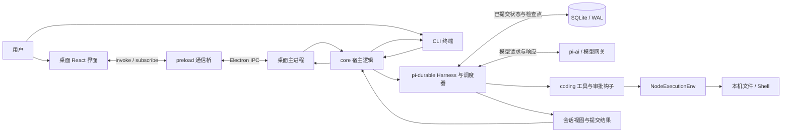
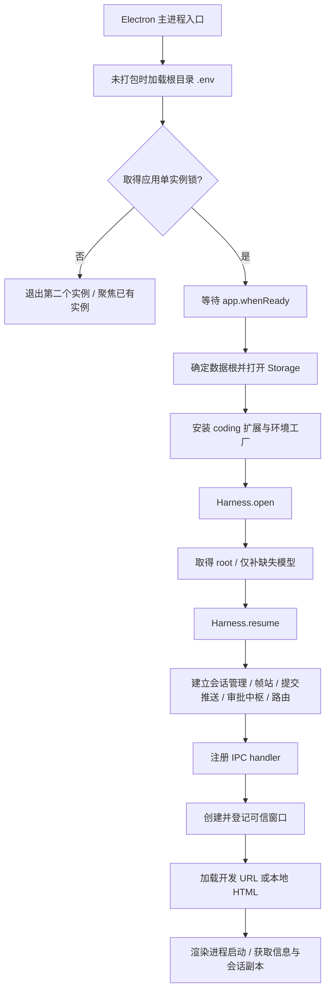
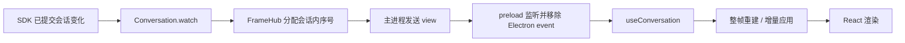
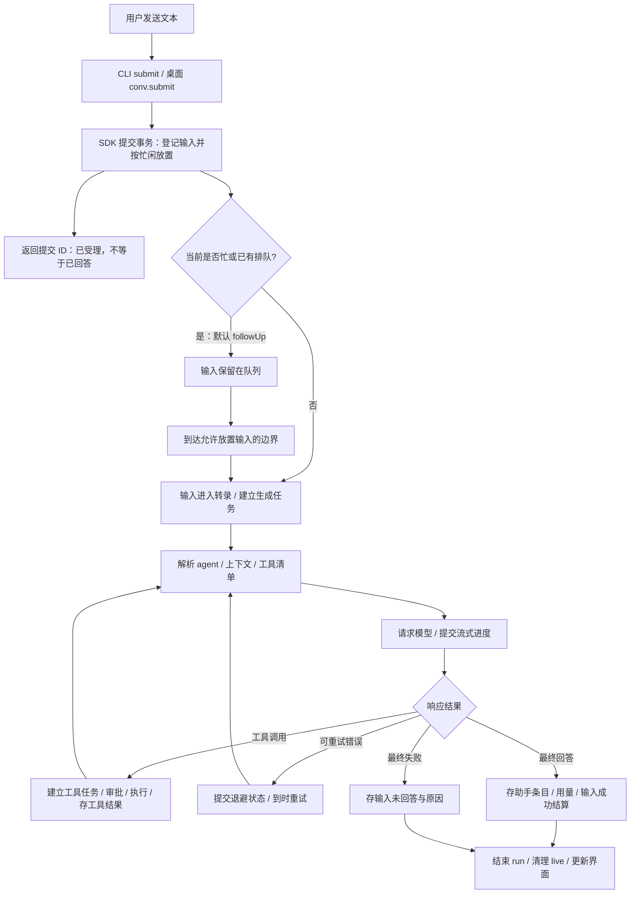
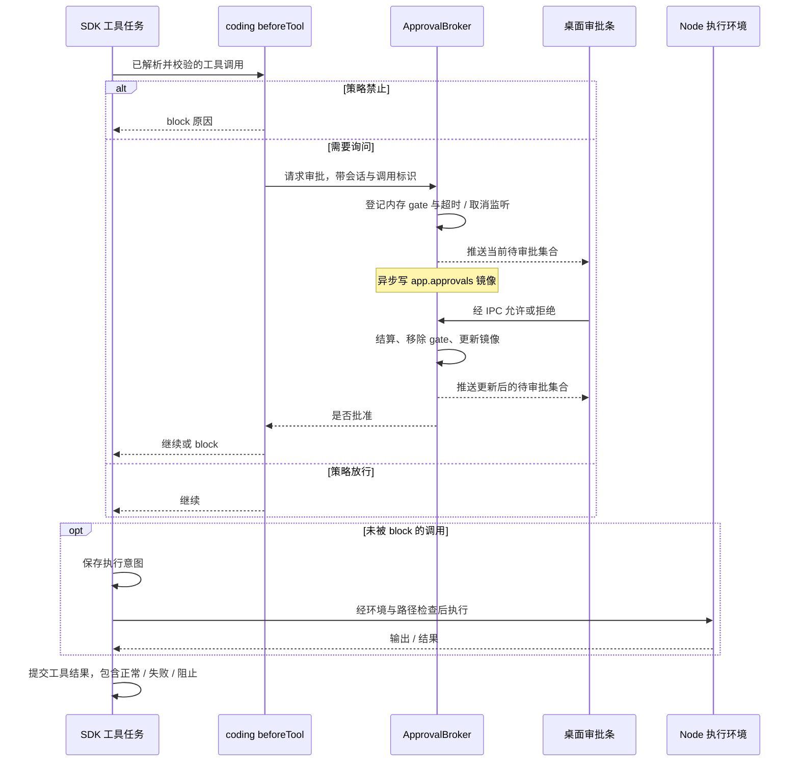

# 项目全景流程

当前项目的主链路是：**用户发出意图 → 宿主提交输入 → SDK 调度模型与工具 → 状态写入本机存储 → CLI / 桌面展示结果**。

> 本文以当前工作区代码为准，包含已实现的默认启动配置、新建会话模型配置、终态错误呈现与浅色 UI。这里只描述实际链路和边界，不把空包、设计方案或未验收行为当成已交付能力。
> 使用说明见 [README](../README.md)，架构决策见 [技术方案](./知识中心/技术方案.md)，差距与待办见 [ROADMAP](./知识中心/ROADMAP.md)。协议与数据结构以源码定义为准，本文不复制完整类型。

## 1. 全景：两种入口，一套 Agent 运行时



- **Agent 运行在本机宿主进程中**：桌面由 Electron 主进程持有 Harness，CLI 由终端进程持有。
- **模型并不因此变成本地离线模型**：当前通过网关发出网络请求，网关地址来自环境配置。
- **桌面不是运行时的另一份实现**：会话操作、存储、帧分发、审批中枢和 IPC 路由都复用 core。
- **共享代码不等于自动共享数据**：CLI 和桌面的默认数据根不同；即使手动指定相同数据库，也不能同时启动两个写者。

### 1.1 各层的实际职责

| 层 | 当前做什么 | 不做什么 |
|---|---|---|
| `apps/desktop` main | 生命周期、窗口、配置加载、装配 runtime、IPC 校验与推送 | 不在渲染进程里运行 Agent |
| preload | 将受限的 `invoke / subscribe` 暴露为 `window.pi` | 不直接暴露 `ipcRenderer`、数据库或 Node 文件接口 |
| renderer | 展示会话副本、输入回执、审批和应用信息；将用户操作变为 IPC 请求 | 不持有 Harness，不直接读写 SQLite，不插入未提交的聊天消息 |
| `apps/cli` | 参数与命令解析、终端输入、审批答复、输出渲染 | 不依赖 Electron |
| `packages/core` | 路径、存储装配、Harness 持有、会话管理、帧站、审批和路由 | 不绑定具体 UI；扩展由宿主注入 |
| `packages/shared-types` | 进程间契约与可在界面使用的纯函数 | 不依赖 pi-durable |
| `packages/shared-docs` | `app.*` 文档与应用条目的持久化定义 | 不自动提供设置页或业务功能 |
| `packages/extensions/coding` | 本机工具、路径守卫、执行前审批 | 不提供操作系统级沙箱 |

当前直接集成的是 **pi-durable + pi-ai + Chord**，不是 pi-coding-agent 的 `AgentSession` 或其 CLI 资源发现流程。当前宿主没有接入自动加载 skills、MCP、项目上下文文件或 OAuth 登录的流程；仓库 `AGENT.md` 是工程约定，不代表应用启动会自动把它注入模型提示。

依据：[桌面运行时](../apps/desktop/src/main/runtime.ts)、[CLI 入口](../apps/cli/src/main.ts)、[导入边界](../eslint.config.mjs)。

## 2. 构建与启动：程序如何成为一个可交互工作区

### 2.1 桌面构建入口

| 入口 | 实际流程 |
|---|---|
| `pnpm dev` | 构建 main / preload → 启动 Vite → 注入开发页地址 → 启动 Electron → 监听源码变化 |
| `pnpm build` | 构建 main、preload、renderer，生成 `dist`，不启动窗口 |
| `pnpm start` | Electron 读取桌面包入口，运行已构建 main，加载本地 renderer 文件 |
| `pnpm cli` | 由 tsx 加载根目录 `.env`，直接运行纯 Node 终端入口 |

桌面产物分为三层：main 是 ESM `.mjs`，sandbox preload 是 CJS `.cjs`，renderer 由 Vite 打包。main 保留 `@earendil-works/*` 外部依赖，因为内联会破坏已发现的 ESM 循环引用；构建目录运行仍需要这些依赖可被解析。

开发期间 renderer 走 HMR；main / preload 重建后，构建脚本会结束旧 Electron 子进程并启动新进程。**这种开发重启不是正常退出协议，也不能替代崩溃恢复验收。**

依据：[构建脚本](../apps/desktop/build/build.ts)、[桌面包入口](../apps/desktop/package.json)。

### 2.2 桌面主进程启动顺序



关键顺序有两条：

1. **先准备 root 模型，再 resume**：避免旧 root 没有模型时直接恢复工作。
2. **先注册 IPC、登记可信窗口，再加载页面**：页面加载期间就会调用 IPC，不能等页面返回后才认可发送方。

模型集合按需创建，因此缺模型或凭证时可以开窗，但不代表可以成功生成回答。存储打不开则启动失败，不会偷偷降级到内存库。

启动期有一个需要保留的恢复边界：`Harness.resume()` 早于 `ApprovalBroker` 建立；扩展在 broker 尚未就绪时按拒绝返回。不能据此宣称恢复中的待审批工作一定会重新弹窗。

依据：[主进程入口](../apps/desktop/src/main/index.ts)、[runtime 装配](../apps/desktop/src/main/runtime.ts)、[Harness 打开顺序](../packages/core/src/harness/open-harness.ts)。

### 2.3 CLI 启动与运行模式

CLI 解析参数后，装配路径、Storage、coding 扩展、模型工厂、HarnessHost、SessionManager 和 FrameHub，再打开起始会话。

- 默认进入 REPL，以 root 为起始会话；传入会话 ID 时先校验存在。
- 普通输入提交后立即回到输入循环，不等待整轮回答；帧分发继续驱动终端输出。
- 一次性模式提交后等待输入结算，成功回答才按成功退出。
- `/new`、`/switch`、`/fork` 调整当前会话；`/reset`、`/compact`、`/abort` 操作该会话；`/inspect` 返回诊断摘要。

终端审批与普通输入共用一个 `CliEventQueue`，只有 REPL 消费 stdin，避免把审批的 `y` 同时当成新问题。

依据：[CLI main](../apps/cli/src/main.ts)、[终端审批队列](../apps/cli/src/approvals.ts)。

## 3. 配置与数据：什么存在本机，什么只属于当前进程

### 3.1 模型配置与会话模型不是一回事

- CLI 与未打包桌面加载根目录 `.env`，已导出的环境变量优先；修改文件后需要重启进程。
- `ANTHROPIC_MODEL` 决定当前网关模型集合中的模型；`ANTHROPIC_BASE_URL` 决定网关地址；API key 在请求鉴权时从环境解析。
- root 首次创建时写入模型选择；旧 root 缺模型时只补模型，不覆盖已有模型或其他保存字段。
- 新建会话默认取 **root 模型**，不复制 root 历史或全部 agent 配置；分叉则继承分叉点的 agent 配置。
- 已保存模型不会因改 `.env` 自动切换。若保存的选择不在当前模型集合中，生成仍可能失败；当前没有桌面模型设置入口。
- 打包后的应用不去寻找开发仓库 `.env`；安装包配置入口尚未验收。

当前网关使用 Anthropic Messages 协议，并配置了特定网关所需的客户端请求头。这不等于已支持任意模型协议。模型描述中的成本目前为零配置，不能据此解释为真实调用免费。

依据：[配置加载](../apps/desktop/src/main/config.ts)、[模型集合](../packages/core/src/agent/models.ts)、[新建会话](../packages/core/src/session/manager.ts)。

### 3.2 数据根与持久化边界

```text
<data-root>/
├─ session.sqlite       会话、条目、提交、任务与文档
├─ workspace/           工具默认工作目录；真实文件存在这里
├─ tools/               工具安装目录预留
└─ logs/                日志目录预留
```

SQLite 使用 WAL，运行时还可能存在 WAL / SHM 附属文件。默认数据根：CLI 为当前目录下 `.data`，桌面为 Electron `userData`；二者都允许显式覆盖。

| 数据 | 当前事实来源 |
|---|---|
| 会话与分叉关系 | Storage 的会话记录 |
| 用户、助手、工具结果与上下文边界 | Storage 的条目记录 |
| 一次输入是否已回答、失败或停止 | Storage 的提交记录 |
| 尚未完成的任务与恢复位置 | Storage 的任务状态与检查点 |
| 会话模型、排队、实时展示、用量 | SDK 的 `pi.*` 文档 |
| 工作区文件 | 本机文件系统，独立于 SQLite 事务 |
| 当前选中的会话、输入草稿、工具展开状态 | renderer 当前 React 状态，未持久化 |
| 审批等待 Promise、帧序号、watch 缓存 | 当前宿主进程内存 |

两个重要限制：

- `--memory` 只替换 Storage，不会把文件和 Shell 副作用变成虚拟操作。
- `tools/` 和 `logs/` 当前只是建立目录。工具自举尚未接入，宿主日志主要写到 console / stderr，不是完整文件日志系统。

`app.approvals` 已用于审批镜像；`app.settings`、`app.workspace` 有定义和读取路径，但当前没有把它们接成完整设置或工作区状态管理功能。

依据：[存储装配](../packages/core/src/storage/create-storage.ts)、[目录布局](../packages/core/src/paths.ts)、[应用文档定义](../packages/shared-docs/src/index.ts)。

## 4. 打开会话：UI 如何取得并保持一份副本

### 4.1 首次建立桌面状态

| 消费者 | 读取与订阅 | 实际用途 |
|---|---|---|
| `useHost` | 应用信息、宿主状态、会话列表与宿主状态推送 | 窗口顶部和侧栏 |
| `useConversation` | `conv.open` 与 `view` 推送 | 当前会话的唯一 `ViewSnapshot` |
| `useApprovals` | 审批列表与审批集合推送 | 当前会话可答复的审批 |
| `useSubmission` | `conv.submission` 与提交状态推送 | 当前 / 最近已开始输入的终态提示 |

App 取得 root ID 后选择起始会话；侧栏切换只改变 renderer 的选中 ID。IPC 路由按请求中的会话 ID 操作，不依赖 CLI 的“当前会话”指针。

### 4.2 帧同步链路



`conv.open` 给出当前完整副本和当前序号，历史已在副本中，不再逐条重放。FrameHub 缓存已打开的 watch；在同一宿主内复用 watch 时序号继续，换进程后重新建立序号，不把它当数据库持久化游标。

客户端按会话、轮次和序号判定帧：别的会话或旧轮次不应用，重复 / 旧帧丢弃，跳号重新打开副本，完整 base 重建，其余操作增量应用。**界面的“重连”只重新取副本，不会重建已经失效的 Harness。**

切走的会话仍可在主进程运行，其 watch 也不会因 renderer 退订而自动停止。重新选回时再取当前状态。

依据：[FrameHub](../packages/core/src/frames/frame-hub.ts)、[副本投影](../packages/core/src/harness/materialize.ts)、[客户端同步](../apps/desktop/src/renderer/src/useConversation.ts)。

## 5. 一次输入：受理、模型请求、工具轮与最终结算



这里的忙闲与放置是 SDK 提交逻辑的一部分，图中分支不代表客户端另做一次无事务的判断。

1. 桌面请求先经过窗口发送方校验、命令白名单和参数校验；CLI 经命令解析进入同类会话操作。
2. `submit` 返回的是持久化输入的受理句柄 / ID，不是模型文本。桌面不会在这个响应中等待整轮模型回答。
3. SDK 生成任务解析会话模型、有效上下文和工具，必要时处理重试或压缩；请求走 pi-ai 网关。
4. 生成进度先写入 live 文档，再由会话视图更新进入界面；网络 token 不直接推给 React。
5. 模型要求工具时，执行并保存工具结果后继续请求模型；这可能跨多个生成 / 工具任务，并不等于“一条输入只请求一次模型”。
6. 最终回答和输入结算保存在 Storage。当前失败策略采用 SDK 默认 `keep`，失败后保留的排队输入不代表会立即自动执行。

默认忙时行为是 `followUp`。core / IPC 还支持 `steer`、`reject`，但桌面没有策略选择器。契约也支持 `requestId` 幂等键，不过当前桌面发送回调没有自动生成它，不能把支持幂等契约等同于 UI 已完成重试去重。

依据：[IPC 路由](../packages/core/src/ipc/router.ts)、[会话管理](../packages/core/src/session/manager.ts)、[模型网关](../packages/core/src/agent/models.ts)。调度内部行为来自锁定版本 pi-durable 的 `dist/harness/generation.js`、`agent.js`。

## 6. 工具与审批：副作用如何被允许或阻止

### 6.1 当前工具策略

| 工具 | 默认审批方向 | 恢复策略 | 执行边界 |
|---|---|---|---|
| `read` | 放行 | safe | 工作区内文件，检查真实路径 |
| `list_dir` | 放行 | safe | 工作区内目录，检查真实路径 |
| `write` / `edit` | 询问 | unsafe，指定串行执行模式 | 批准后仍需通过路径守卫 |
| `bash` | 根据命令分类：放行 / 询问 / 禁止 | unsafe，指定串行执行模式 | 校验起始 cwd；Shell 本身不是沙箱 |

只读命令按现有规则放行；危险命令模式禁止；其他命令询问。命令分类是策略规则，不是完整 Shell 安全证明。`read / write / edit / bash` 复用 SDK 工具，本仓库补充目录工具、路径边界与审批。

### 6.2 桌面审批链路



- 待批集合不是操作结果；**只有获准且通过后续检查的工具才会执行**。
- 默认超时为 120 秒；超时、无审批通道、取消和关闭不会当成批准。
- CLI 只有交互式 REPL 可以答复询问；管道输入和一次性模式按拒绝处理。
- 审批等待监听取消信号，停止或关闭不必等满超时。

这里有一个与会话帧不同的实际实现：**审批推送先响应内存 gate 变化，审计镜像异步写入**。真正放行的是 gate Promise，不是 `app.approvals`。当前审计写入会捕获错误，不能将它解释为完整、必达的审批审计系统；也不能把保存的旧批准当作下次进程的授权。

### 6.3 文件边界与崩溃重放

文件工具使用工作区路径守卫，包括词法边界和真实路径检查。NodeExecutionEnv 每次按目标 cwd 创建，默认回落到工作区。`bash` 可以在执行后切换到外部目录，约束主要靠审批；renderer 的 Chromium sandbox 不等于工具的操作系统沙箱。

SDK 在执行前保存意图。意图后恢复时，只有保存策略与当前工具策略都为 safe 才可重跑；unsafe 调用可能已经部分执行，不会盲目再次运行。**SQLite 提交和文件 / Shell 副作用不是同一个事务，不能承诺任意强杀下恰好执行一次。**

依据：[coding 扩展](../packages/extensions/coding/src/index.ts)、[路径守卫](../packages/extensions/coding/src/guard.ts)、[命令策略](../packages/extensions/coding/src/policy.ts)、[审批中枢](../packages/core/src/approvals/broker.ts)、[执行环境](../packages/core/src/agent/env.ts)。重放细节见 SDK `dist/harness/tool.js`。

## 7. 结果展示：为什么既要视图，也要输入回执

会话结果有两条互补链路：

| 链路 | 服务的事实 |
|---|---|
| 会话 watch → FrameHub → `view` → `useConversation` | 生效消息、当前 live 文本、工具状态、队列、上下文边界 |
| 提交记录变化 → `materializeSubmission` → `submission` → `useSubmission` | 输入成功、未回答、停止及可持续读取的终态 |

run 结束时 SDK 清理 `pi.live.generation / tools / nestedTools`，所以 live 适合展示进行中的工作，不适合单独保存最终失败。桌面通过 `conv.submission` 在切换或重启后恢复当前 / 最近已开始输入的回执，并合并之后的推送。

恢复读取会跳过纯写入提交与后续未开始的队列输入，避免遮住当前失败；客户端也不会让迟到的读取覆盖较新的状态或同一提交的终态。主动 `aborted / reset` 不当作模型失败，已经离开当前生效上下文的旧错误也不重新展示。

界面的呈现规则：

- 系统条目不显示；只有工具调用而无文本的助手条目不占空行。
- 用户文本按纯文本显示，助手回答走默认转义的 Markdown，不启用原始 HTML。
- live 文本与最后助手条目相同时只显示条目，避免重复回答。
- live 工具槽按调用 ID 更新；run 结束后从持久化工具结果回看输出。
- 重置 / 压缩分隔线只对应已提交边界，不由按钮点击自行插入。
- 当前会话视图是生效范围，不是数据库里全部旧历史；旧条目不因不显示而被删除。

当前 UI 是浅色工作区：侧栏承载会话与操作，主区承载对话、工具与审批，输入固定底部。顶栏模型信息来自宿主 root 配置，不是模型选择器；调试条的会话内序号也不是任务或存储成功率指标。

依据：[提交投影](../packages/core/src/harness/submissions.ts)、[输入回执 hook](../apps/desktop/src/renderer/src/useSubmission.ts)、[合并与错误选择](../packages/shared-types/src/submission.ts)、[消息列表](../apps/desktop/src/renderer/src/components/MessageList.tsx)、[消息行](../apps/desktop/src/renderer/src/components/MessageRow.tsx)。

### 7.1 异常按范围处理

| 异常范围 | 当前路径与边界 |
|---|---|
| 请求 / 用户状态错误 | 路由返回结构化错误，renderer 封装为带码异常，App 显示可关闭提示；不伪造成功 |
| 模型配置、鉴权、请求最终失败 | 桌面从 live 展示重试、从输入回执展示终态；CLI 一次性模式按结算结果退出，REPL 不使用同一套终态横幅；需要修配置或重新发出意图 |
| 存储失败 `SessionFailed` | Harness 已不可继续使用；CLI 在操作捕获到它时退出，桌面完整失败态与重建入口尚未接入 |

“重连副本”不能修复 `SessionFailed`。当前 runtime 未监听 `HarnessHost.closed` 来驱动完整的宿主不可用状态，不能宣称异常恢复闭环已经完成。

## 8. 会话操作：改变的是哪一部分状态

| 用户动作 | 核心动作 | 对历史与配置的影响 |
|---|---|---|
| 新建 | SessionManager 创建 ownerless 会话 | 空历史、无父链，默认取 root 模型；显式 agent 覆盖优先 |
| 切换 | CLI 改 manager 指针；桌面改选中 ID 并重新打开副本 | 不复制会话、不停止其他会话工作；当前选择未持久化 |
| 分叉 | 默认取得最新可见条目，再执行 fork | 建父链引用，继承截至分叉点的历史和配置；空会话报错 |
| 重置 | 提交上下文重置边界 | 改变有效上下文，不删除旧条目；可带交接说明 |
| 压缩 | 创建 compaction task，等待终态 | 有摘要时提交边界；无可压缩内容时可没有新条目；失败可留在 live 的压缩失败状态 |
| 停止 | conversation.abort | 撤回相关排队输入、持久化取消意图并等待普通工作停止；解除审批等待，不是假插“已停止”消息 |

桌面分叉、压缩、重置在当前会话生成中禁用。CLI 与 core 的能力不应等同于桌面已有所有高级操作：当前没有消息级分叉、复制 / 引用、队列策略选择或错误重试按钮。

依据：[会话管理](../packages/core/src/session/manager.ts)、[桌面回调与禁用状态](../apps/desktop/src/renderer/src/App.tsx)、[输入 / 停止控件](../apps/desktop/src/renderer/src/components/Composer.tsx)。

## 9. 退出与重启：恢复状态，不恢复内存承诺

### 9.1 正常退出顺序

桌面 `before-quit` 阻止立即退出，并等待以下收尾：

```text
注销 IPC handler
  → 推送宿主 closing
  → 停止 view 分发与 submission 监听
  → 结算所有内存审批 gate
  → 停止全部会话 watch
  → 关闭 Harness（停止当前调用、关闭 Storage）
  → app.quit
```

CLI 在退出时先关闭输入与待批队列，再停帧和 manager watch，最后关闭 HarnessHost。关闭是幂等操作；退出本身不等于把未完成任务标为成功。

**macOS 关闭窗口不等于退出应用**：主进程和工作仍可继续；再次激活创建新页面，从 root 重新建立副本。非 macOS 关闭全部窗口会触发退出。

### 9.2 重新启动

同一数据根重新打开 Storage 后，取得 root、补缺失模型并 resume；SDK 根据已保存任务状态恢复调度。会话、历史、工作区文件和输入终态仍可读取。

不会因此恢复的内容包括：上次选择的界面会话、草稿、展开状态、原帧序号和原审批 Promise。审批列表以新进程的 gate 为准，并尝试清理旧镜像；unsafe 副作用按重放规则处理，而不是因重启自动批准或重复执行。

已验证的是普通退出重开与若干持久化 / 模型 / 审批链路。执行中强杀的五类场景尚未完整验收；当前 `crashPoint()` 只有定义，没有接到运行阶段，单独设置 `PI_CRASH_POINT` 不会自动触发测试。

依据：[主进程生命周期](../apps/desktop/src/main/index.ts)、[runtime.close](../apps/desktop/src/main/runtime.ts)、[HarnessHost](../packages/core/src/harness/host.ts)、[崩溃开关](../packages/core/src/dev/crash-point.ts)。

## 10. 验证与交付边界

| 检查 | 能证明什么 | 不能替代什么 |
|---|---|---|
| typecheck / lint | 类型与导入边界检查 | 运行时与界面验收 |
| `pnpm test` | core、工具策略、CLI、桌面纯 Node 装配、本地模型、配置恢复、终态恢复与 UI 静态渲染 | 真实窗口里的完整鼠标 / 键盘 / 所有竞态 |
| `pnpm smoke` | 真实 CLI 装配与无模型 REPL 命令 | 模型请求、桌面窗口、完整工具审批 |
| `pnpm build` | 三层构建产物可生成 | 安装包能启动 |
| `pnpm gate` | Electron 内置 Node 能完成真实 SQLite / WAL 读写 | asar 内路径与分发后的运行环境 |
| 桌面人工 / CDP 验收 | 已观察的对话、审批、排队、停止、Markdown、错误与窗口尺寸行为 | 全平台、任意强杀与完整恢复矩阵 |

CI 当前分为基础检查和桌面构建两条任务；真实窗口、存储门禁与安装包运行不是当前 CI 的完整自动验收范围。

打包使用 electron-builder 的 asar 配置，但 main 有外部 SDK 依赖，打包配置又包含排除 `node_modules` 的规则。最终依赖收集、SQLite 和动态导入在安装包内是否成立，需要实际打包验证，不能沿用“都内联了所以无运行时依赖”的假设。

当前主链路之外的边界：

- 知识库、工具自举、智能 UI 三个扩展仍是空实现，没有进入注册和任务执行流程。
- 没有数据库跨进程写者锁；Electron 应用单实例锁不能阻止 CLI 同时打开同一个库。
- 模型设置、旧版非 root 空模型会话迁移、宿主存储失败恢复、执行中强杀与安装包验收尚未完成。
- 侧栏忙碌 / 排队标记只在查询刷新时更新，可能残留；消息滚动仍会自动到底，不保留用户上翻位置。
- 部分读取失败目前被 hook 捕获而不展开提示；不能把窗口显示“启动中”或旧副本仍可见当作完整错误恢复。

依据：[CI](../.github/workflows/ci.yml)、[运行时回归](../apps/desktop/src/main/runtime.test.ts)、[UI 回归](../apps/desktop/src/main/ui-render.test.ts)、[打包配置](../apps/desktop/electron-builder.yml)、[当前差距](./知识中心/ROADMAP.md)。

## 11. 按问题定位源码

| 要核对的链路 | 首先看哪里 |
|---|---|
| 构建与加载入口 | [build.ts](../apps/desktop/build/build.ts) → [main/index.ts](../apps/desktop/src/main/index.ts) |
| 模型配置与旧 root 补配置 | [models.ts](../packages/core/src/agent/models.ts) → [open-harness.ts](../packages/core/src/harness/open-harness.ts) |
| 一次输入 / 会话操作 | [router.ts](../packages/core/src/ipc/router.ts)、[manager.ts](../packages/core/src/session/manager.ts) |
| 模型之后为什么要执行工具 | coding 扩展 → SDK `dist/harness/generation.js / tool.js` |
| 为什么没有执行或还在等待批准 | [coding/index.ts](../packages/extensions/coding/src/index.ts) → [broker.ts](../packages/core/src/approvals/broker.ts) |
| UI 为什么没更新 | [FrameHub](../packages/core/src/frames/frame-hub.ts) → [preload](../apps/desktop/src/preload/index.ts) → [useConversation](../apps/desktop/src/renderer/src/useConversation.ts) |
| run 结束后为什么还能看到失败 | [submissions.ts](../packages/core/src/harness/submissions.ts) → [useSubmission](../apps/desktop/src/renderer/src/useSubmission.ts) |
| 命令、推送、错误与数据结构的权威定义 | [shared-types](../packages/shared-types/src/index.ts)、[shared-docs](../packages/shared-docs/src/index.ts) |
| 终端输入为什么与审批共用一个循环 | [CLI main](../apps/cli/src/main.ts)、[approvals.ts](../apps/cli/src/approvals.ts) |

**整体判断：当前已具备“配置启动 → 会话 → 模型 / 工具 → 审批 → 持久化 → 展示 → 普通重启读取”的本机最小主链路；完整异常恢复、沙箱隔离、扩展业务与安装包交付不是这个结论的一部分。**
